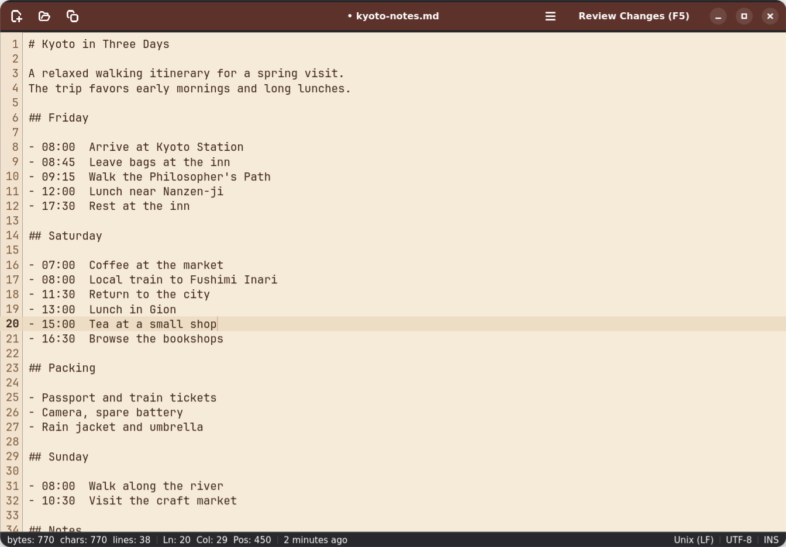
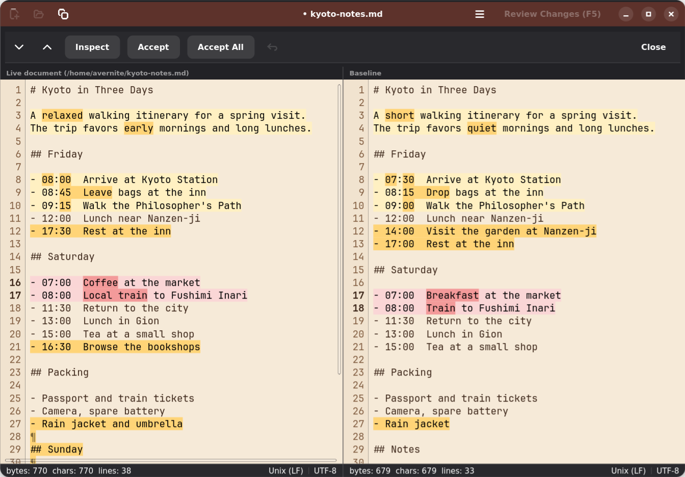
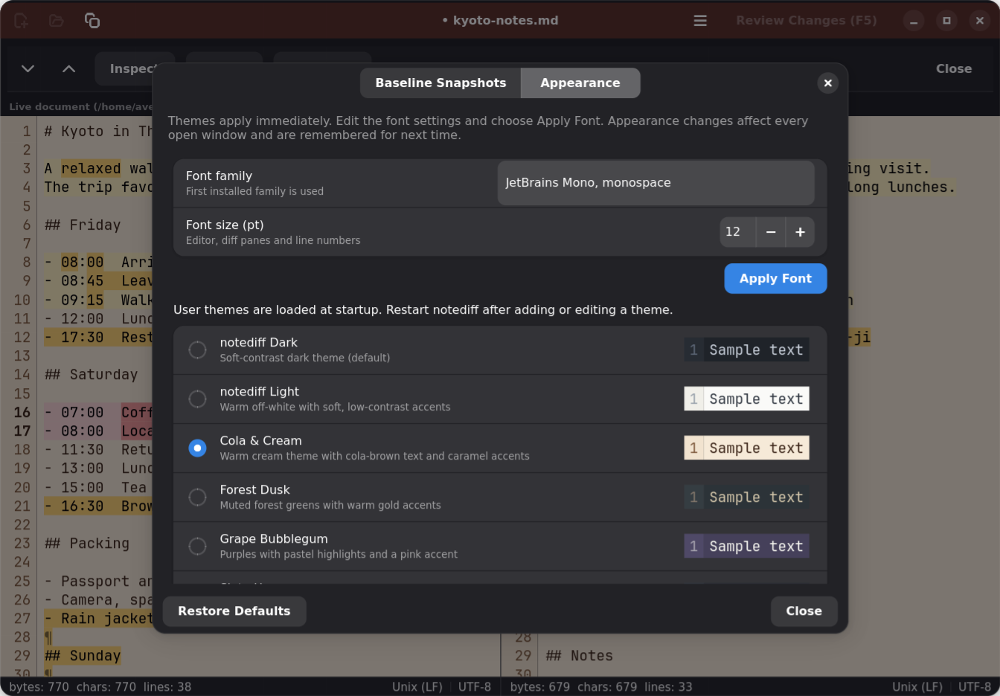

# notediff

A single-user desktop editor for plaintext and Markdown with a
baseline-comparison **Diff Mode**. Built with Rust, GTK 4, libadwaita and
GtkSourceView 5 for Linux.

The live file is always the source of truth. Each document has at most one
baseline snapshot, kept in a central folder and advanced hunk by hunk. If the
link between a file and its baseline breaks, only the comparison is lost —
never the document.

## Features

- Plain-text editing with no tab characters, undo, search and replace, word
  wrap, line numbers and configurable content fonts.
- A recent-documents menu on the header Open button, with up to ten file paths,
  lazy pruning and per-entry deletion.
- Full-path title tooltip and a right-click title menu for copying the file name
  or full path.
- **Diff Mode**: compare the live file against a saved baseline, inspect whole
  hunks or individual word-level changes, and accept them one at a time.
- Baselines can be created, moved, copied and re-linked when files move on disk.
- Atomic saves and baseline writes, including a direct-write fallback for shared
  folders that reject sibling renames.
- Light and dark themes plus user theme bundles.
- **Run Script… (`F6`)**: run local scripts with a dynamic parameter form
  defined in a script comment header, optional bubblewrap (`bwrap`) sandboxing,
  and stdout opened in a new read-only window.
- Explicit protection against external file changes and oversized or binary
  files. The 16 MiB limit applies to opening, reloading, saving and baselines,
  so the app cannot create a file it would refuse to reopen.

## Screenshots



*The editor, with line numbers and the status bar.*



*Review Changes: the live document on the left and the baseline on the right.*



*Appearance settings: themes, font controls and user theme previews.*

## Requirements

- Rust **1.92 or newer**, installed with [rustup](https://rustup.rs).
  Debian trixie’s packaged Rust is 1.85; the GTK bindings need a newer toolchain.
- GTK **4.18+**, libadwaita **1.7+** and GtkSourceView **5.16+** development
  packages. Debian 13 (trixie) is the reference environment. Ubuntu 24.04 is
  too old.

On Debian 13:

```sh
sudo apt install build-essential pkg-config \
  libgtk-4-dev libadwaita-1-dev libgtksourceview-5-dev
```

## Install

From a checkout:

```sh
./install.sh
```

The installer builds with `cargo install --locked`, installs the binary with
Cargo (normally under `~/.cargo/bin`), places the desktop entry, icons and
example scripts under `$XDG_DATA_HOME`, and checks the Rust and GTK versions
first. To remove it:

```sh
./uninstall.sh
```

Snapshots and settings under `$XDG_DATA_HOME/notediff` are left alone.

Distribution builds can be made about a third smaller with stripping and fat
LTO; see [Production builds](docs/development.md#production-builds).

To run a development build:

```sh
cargo run --release -- /path/to/notes.md
```

## Quick start

- **Ctrl+N** starts a new file in the current window, prompting to save or
  discard unsaved changes first. **Ctrl+Shift+N** opens a new window, as does
  Shift-clicking the header New button. **Ctrl+O** shows the file chooser first;
  the header Open button opens a menu with a path field and a **Browse…** button
  plus the recent files, each with its own hide button. Type a path and press
  Enter to open it. If the current document is dirty, choose
  Open New Window, Discard Changes, or Save. A command-line path or a
  file-manager launch opens a new window. If a file is already open in another
  window, that window is raised instead of opening the same file twice;
  reopening the current window's file reloads it from disk. New File and Open
  File are unavailable while Review Changes is open; New Window remains
  available.
- **Ctrl+S** saves. **Ctrl+Shift+S** saves as, except while Review Changes is
  open.
- Click **Review Changes (F5)** to compare with a baseline.
- Use **Ctrl+Q** to quit. Every window is handled at once: clean windows close
  immediately, while each dirty window or window with accepted review changes
  shows its own prompt.

## Keyboard shortcuts

| Shortcut | Action |
| --- | --- |
| `Ctrl+N` | New file (replaces the current document) |
| `Ctrl+Shift+N` | New window |
| `Ctrl+O` | Open file in this window |
| `Ctrl+S` / `Ctrl+Shift+S` | Save / Save As |
| `F2` | Rename or Move |
| `F5` | Review Changes (Diff Mode) |
| `F6` | Run Script… |
| `Ctrl+F` / `Ctrl+H` | Find / Replace |
| `F3` / `Shift+F3` | Next / Previous match |
| `Ctrl+G` | Go to Line |
| `Ctrl+]` / `Ctrl+[` | Increase / Decrease indentation |
| `Ctrl+Shift+]` / `Ctrl+Shift+[` | Double / Halve indentation |
| `Alt+Z` | Toggle word wrap |
| `Ctrl+W` / `Ctrl+Q` | Close Window / Quit |
| `Up` / `Down` | Previous / next hunk or change |
| `Right` / `Left` | Accept / undo the focused change |
| `Enter` | Inspect the focused hunk, or return to the full diff |
| `Esc` | Close Find/Replace; leave inspection; in the full diff, leave Diff Mode, confirming first when changes have been accepted |

New File, Open File, Save As and Rename or Move are disabled while Review Changes
is open; the disabled New File and Open File header buttons also lose their
tooltips. New Window remains available.

## Documentation

- [Using notediff](docs/usage.md) — the full editor, Diff Mode and appearance
  behaviour.
- [Writing Scripts](docs/scripts.md) — full specification for authoring Run
  Script (`F6`) scripts.
- [Design](docs/design.md) — architecture, invariants and product decisions.
- [Development](docs/development.md) — module layout, tests and CI.
- [Releasing](docs/releasing.md) — versioning, release checks and publishing.
- [Changelog](CHANGELOG.md)
- [GitHub repository](https://github.com/AverniteDF/notediff)

## License

MIT. See [LICENSE](LICENSE).
